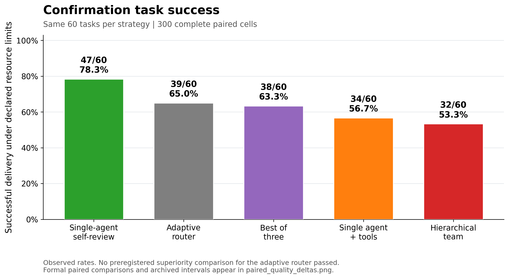
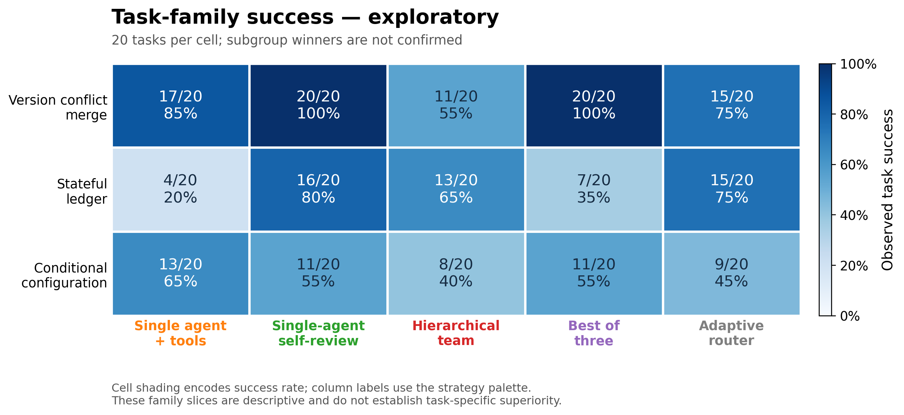

# Agent Org Bench

**Which collaboration mechanisms help which tasks, and are their gains worth the extra work?**

A reproducible comparison of single-agent solving, self-review, hierarchy, independent candidate search, audit and routing under one model, shared tools and declared resource limits.

**Independent confirmation:** the router solved **39/60 (65.0%)**, versus **47/60 (78.3%)** for single-agent self-review. None of the router's four preregistered superiority comparisons passed. Self-review had the highest observed success rate; universal optimality is not established.

[简体中文](README.zh-CN.md) · [Architecture diagrams](docs/architecture_catalog.md) · [Tasks and examples](docs/task_examples.md) · [Full results](docs/results.md) · [Conclusions](docs/conclusions.md)

## Study design

1. Development: nine tasks × nine policies, giving 81 task runs.
2. Select and freeze one of four non-control candidates. The router solved 8/9 development tasks; self-review solved 9/9. Candidate selection was not an overall victory.
3. Confirmation: 60 fresh tasks × five arms, giving 300 paired task runs, using `deepseek-v4-pro` in non-thinking mode.
4. Shared per-task ceilings cover calls and input/output resources. Actual usage and latency are recorded separately; equal ceilings do not mean equal compute.

[Methods](docs/methods.md) · [Study status](docs/study-status.md) · [Reproduction](docs/reproducibility.md)

## Architectures and controls

| Role | Policy | Mechanism |
|---|---|---|
| Primary quality control | Single-agent self-review | Retained visible history; generation, review and revision |
| Secondary control | Single + tools | Actual public tests and failure-triggered repair |
| Secondary control | Hierarchy | Router, two isolated reports, integration and optional repair |
| Secondary control | Best-of-three | Three complete independent proposals, selected by public tests |
| Selected candidate | Fixed router | Public-task features choose a tool single agent or audit team |

Development also tested one-shot solving, two-proposal bazaar, independent audit and evidence-gated escalation. See the [nine mechanism cards](docs/architecture_catalog.md) for context access, allocation, acceptance and stopping. These are simplified mechanisms, not official reproductions of DSH, AutoGen or other frameworks.

## Evaluation tasks

The confirmation contains 20 tasks in each synthetic repair family:

- **Version merging:** resolve conflicts under semantic precedence rules.
- **Stateful ledger:** process ordered events with idempotency, freezing and reversal constraints.
- **Conditional configuration:** implement dependencies, conditions, patch order and merge rules.

Each task supplies a wrong starter, complete rules and three public input/output examples. Solvers receive only public information and actual public execution feedback. Final scoring uses 30 hidden cases and input-immutability checks. Success requires completion within the declared policy/resources and all terminal checks, rather than public-example success alone.

[Concrete examples](docs/task_examples.md) · [Public specifications for all 60 confirmation tasks](datasets/README.md)

## Results

| Policy | Tasks solved | Success rate | Mean input + output tokens/task |
|---|---:|---:|---:|
| Self-review | 47/60 | 78.3% | 16,896 |
| Fixed router | 39/60 | 65.0% | 12,323 |
| Best-of-three | 38/60 | 63.3% | 13,047 |
| Single + tools | 34/60 | 56.7% | 10,514 |
| Hierarchy | 32/60 | 53.3% | 17,205 |





The router minus self-review difference was −13.3 percentage points, with a 95% paired interval of [−28.3, +1.7] and p=0.115. Its observed token use was about 27.1% lower, alongside lower observed quality. This does not establish equal-quality savings, equivalence or noninferiority.

[Full statistics and resources](docs/results.md) · [Paired differences and intervals](results/main/paired_quality_deltas.png) · [Interpretation](docs/conclusions.md)

## Reproduce

Python ≥3.11; the core uses the standard library. These commands are offline:

```bash
python -m unittest discover -s tests
python analysis/analyze_public_results.py
# Optional plotting dependency: python -m pip install -e ".[report]"
python analysis/make_public_figures.py
```

The [reproduction guide](docs/reproducibility.md) distinguishes new model runs, the public reproduction plan and original registrations. Internal identifiers remain in code and immutable audit records for traceability.

## Conclusions and next question

More roles, calls or routing do not automatically improve delivery. Strong single-agent self-review is a necessary control here. The next question is **when an additional review is worth its cost, what observable evidence should trigger it, and when to stop**. Shared-draft review is a proposed follow-up, not a completed model experiment.

This study covers one model, three finite synthetic families and a restricted AST executor. It does not establish outcomes for all multi-agent systems or real repositories. [Known limitations](docs/known_limitations.md) · [Data policy](docs/data-policy.md)

Earlier explorations live in the [research archive](archive/README.md) and do not enter this study's ranking. A project license [has not yet been selected](LICENSE-NOTICE.md).
