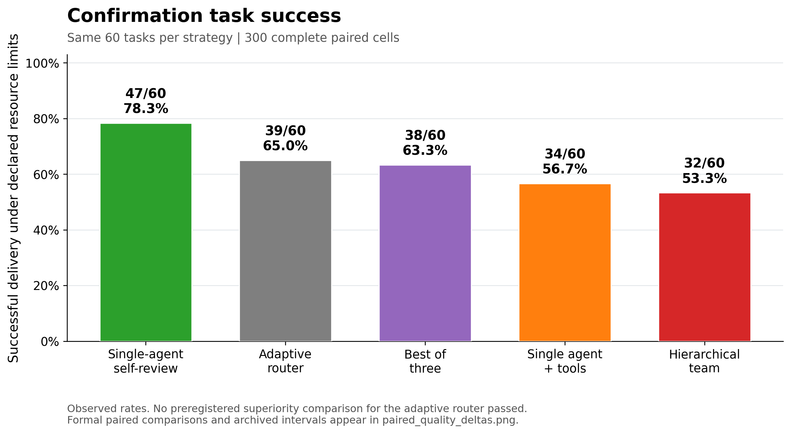
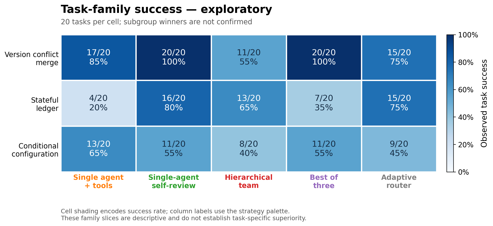

# Agent Org Bench

**什么样的协作机制适合什么任务？它带来的收益，是否值得额外开销？**

本项目在相同模型、任务、工具和资源上限下，比较单体、自检、层级协作、独立候选搜索、审计与路由策略。组织名称对应可执行的信息流与停止规则。

**完整确认实验：新路由成功39/60（65.0%），单体自检成功47/60（78.3%）。新路由对四个基准均未通过预注册优势检验。** 单体自检取得最高观察成绩；这不等于证明它普遍最优。

[English](README.md) · [架构与流程图](docs/architecture_catalog.md) · [任务与样例](docs/task_examples.md) · [完整结果](docs/results.md) · [实验结论](docs/conclusions.md)

## 研究设计

1. 开发阶段：9道题×9种策略，共81个运行单元。
2. 从四个非基准候选中选定一个并冻结。选中新路由开发成功8/9，单体自检9/9；“被选中”不等于胜过基准。
3. 独立确认：60道全新任务×5组，共300个运行单元。模型为 `deepseek-v4-pro`，非思考模式。
4. 各组共享工具与单题资源上限；实际调用、输入／输出Token和延迟分别计量。共享上限不等于相同实际计算量。

[实验方法](docs/methods.md) · [实验状态](docs/study-status.md) · [复现指南](docs/reproducibility.md)

## 架构与基准

| 类型 | 策略 | 实际机制 |
|---|---|---|
| 主要质量基准 | 单体自检 | 保留自身可见历史，执行生成、审查与修订 |
| 次要基准 | 工具单体 | 执行公开测试，仅在失败时修复 |
| 次要基准 | 层级协作 | Router、两个独立分析者、整合与必要修复 |
| 次要基准 | 三候选择优 | 独立生成三个完整程序，依据公开测试选择 |
| 确认候选 | 固定路由 | 按公开任务特征选择工具单体或审计团队 |

开发阶段另比较单次无修复、双候选集市、独立审计团队和证据门控。九种实现的上下文、阶段配额、合并与停止规则见[逐项架构卡](docs/architecture_catalog.md)。这些是机制原型，不是DSH、AutoGen等框架的官方复现。

## 验证任务

三类合成代码修复任务，各20道确认题：

- **版本合并**：根据语义优先级解决版本冲突。
- **状态账本**：按顺序处理幂等、冻结、撤销等事件与约束。
- **条件配置**：处理条件、依赖、补丁顺序和合并规则。

每题提供错误starter、完整规则与3个公开输入／输出例子。模型只使用公开信息和实际公开执行反馈；终局使用30个隐藏例，并检查输入不可变。评分要求在规定资源内完成流程并通过全部验收，公开例通过不等于全题正确。

[完整任务示例](docs/task_examples.md) · [60题公开题面](datasets/README.md)

## 实验结果

| 策略 | 成功任务 | 成功率 | 平均Token／题 |
|---|---:|---:|---:|
| 单体自检 | 47/60 | 78.3% | 16,896 |
| 固定路由 | 39/60 | 65.0% | 12,323 |
| 三候选择优 | 38/60 | 63.3% | 13,047 |
| 工具单体 | 34/60 | 56.7% | 10,514 |
| 层级协作 | 32/60 | 53.3% | 17,205 |





候选相对自检的成功率差为−13.3个百分点，95%配对区间为[−28.3,+1.7]，p=0.115。新路由观察Token少约27.1%，同时成功率点估计更低，不能据此声称同质量省成本。未发现显著差异也不等于等效或非劣。

[完整统计与资源表](docs/results.md) · [配对差与区间图](results/main/paired_quality_deltas.png) · [结论与限制](docs/conclusions.md)

## 复现

Python ≥3.11，核心使用标准库。以下命令离线执行，不调用模型：

```bash
python -m unittest discover -s tests
python analysis/analyze_public_results.py
# 可选绘图依赖：python -m pip install -e ".[report]"
python analysis/make_public_figures.py
```

[复现指南](docs/reproducibility.md)说明新模型运行、公开复现计划及与原注册记录的区别。代码模块和原始审计材料保留内部标识，以确保记录可追溯。

## 结论与后续问题

增加角色、调用或路由并不天然改善结果。当前证据支持把强单体自检作为必要基准，并继续研究：**同一份初稿上，什么时候追加审查值得、什么公开信号能够触发协作、何时应停止？** 共享初稿审查是后续研究方案，尚无新的模型实验结论。

本研究限于一个模型、三类有限合成任务及受限AST执行器，不能推广为所有多Agent系统或真实仓库的结论。[已知限制](docs/known_limitations.md) · [数据政策](docs/data-policy.md)

前期探索集中保存在[研究归档](archive/README.md)，不进入本轮结果表或排名。项目许可证[待作者选择](LICENSE-NOTICE.md)。
