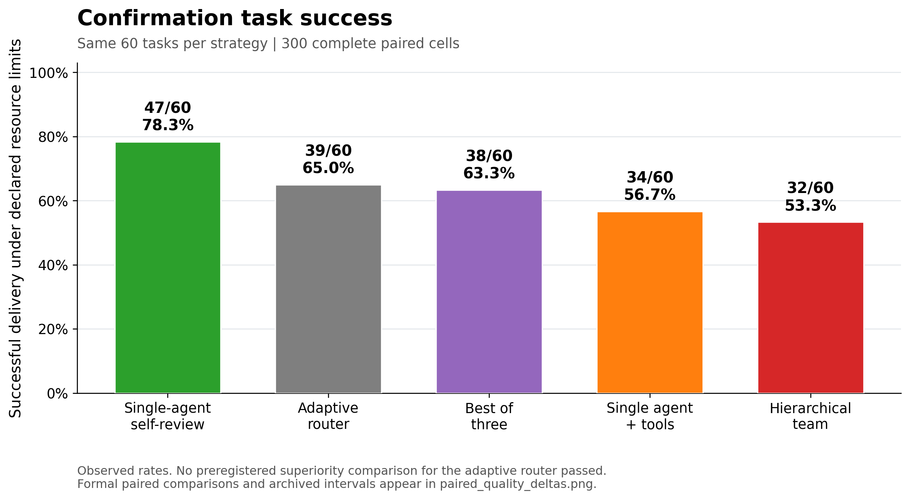
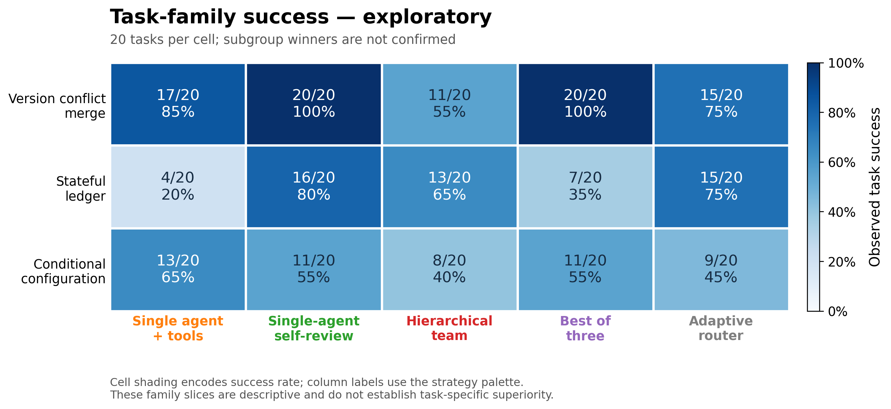

# Agent Org Bench

用于构建、比较和评测 Agent 协作机制的研究项目。核心问题是：**什么机制适合什么任务，以及它是否值得额外的协作开销。**

**最新v6r1确认：新路由39/60（65.0%），强单体自检47/60（78.3%）。新策略对四个对照均未通过预注册的优势检验。** 本项目保留负结果，不宣称新组织必然更好。[最新结果](docs/results-v6.md)

[English](README.md) · [架构与流程图](docs/architecture_catalog.md) · [具体任务与样例](docs/task_examples.md) · [实验结论](docs/conclusions.md) · [复现](docs/reproducibility.md) · [已知限制](docs/known_limitations.md)

这里的组织是统一工具与预算下的简化机制实现，不是 DSH、AutoGen 等项目的官方原版复现，也不宣称找到普遍最优架构。

## v6结果

已完成81个开发运行和300个新题确认运行；冻结候选为`adaptive_tools`。开发单体自检9/9，候选8/9，候选不是开发总体第一。

主要比较（对single_self_review）：未确认优势。次要比较分别为：`single_tool`=not confirmed; `hierarchy_tool`=not confirmed; `best_of_three`=not confirmed.

未确认优势不等于等效或非劣；Token比只描述。

[完整双语结果](docs/results-v6.md) · [研究状态](docs/study-status.md)





候选对四种基准的配对差和原始95%区间见[比较图](results/v6/paired_quality_deltas.png)。总体检验没有通过，分族点估计不能升级成已确认的适用规则。

## 历史v5证据（单独保留）

v5 在同一模型、三类生成型代码修复任务上完成了独立确认，每组90题：

| 策略 | 全对任务 | 成功率 |
| --- | ---: | ---: |
| 公开特征路由 `adaptive_tools` | 66/90 | 73.33% |
| 工具单体 `single_tool` | 44/90 | 48.89% |
| 简化层级 `hierarchy_tool` | 41/90 | 45.56% |

两个预注册质量比较均通过。**预注册的 Token 效率检验没有通过**：相对单体的观察Token比为0.936，95%配对区间约[0.801,1.100]。[完整结果与边界](docs/results-v5.md)

这不是纯拓扑因果证明。额外复核、角色提示、上下文边界和阶段预算也发生变化；路由分数在每个模板内恒定，其中两族运行与单体相同的实现。v6补上了调用轮次和阶段配额匹配的单体自检，未确认新策略优势；不能把额外复核的收益全部归因于组织。

## 比较对象与验证任务

这里的Agent是同一模型的不同调用上下文与调度机制。九种现行策略有可运行实现；另保留十二个历史命名配置，各自流程与验证状态见[架构卡](docs/architecture_catalog.md)，不能拼成21组统一排行榜。

基准包括：**单次无修复**（仅开发）、**工具单体**（公测失败才修复）、**单体自检**（主要质量参照）、**Router—Workers层级**、**三次独立候选择优**。新候选是双分支集市、独立审计团队、固定路由和证据门控。新策略只在四个非控制候选中选择，不能把“选中”当作胜过基准。

三类任务分别要求实现：带语义优先级的版本合并；包含幂等、冻结、撤销等约束的状态账本；包含条件、依赖、顺序与合并规则的配置处理。每题提供错误starter、完整规格和3个公开例，最终用30个隐藏例验收并检查输入不可变。公开测试通过不等于全题正确。

[阅读具体输入／输出示例](docs/task_examples.md)，或检查[全部已退休公开题面](datasets/README.md)。质量、调用、Token及延迟均记录；新组织并没有被预设为赢家。

## 离线使用

Python **≥3.11**，核心仅使用标准库。

```bash
python -m unittest discover -s tests
python -m orgbench.study_v6 --help
# 不调用模型，复算公开确认指标：
python analysis/analyze_public_results.py
# 用公开指标重新画图（需可选matplotlib）：
python analysis/make_public_figures.py
```

主CI只运行离线测试，不运行模型实验、不注入供应商凭据。可选绘图使用 `matplotlib`；独立原生pilot工具可选使用 `cryptography`，两者均不是核心测试依赖。

```bash
python -m pip install -e ".[report]"
# 仅使用独立原生pilot工具时需要：
python -m pip install -e ".[native]"
```

真实模型执行必须显式启动，按CLI帮助与[复现说明](docs/reproducibility.md)配置；导入包或跑离线测试不应自动联系供应商。

## 评测与发布边界

评价任务全对、隐藏用例比例、实际可观测Token与调用、基础设施失败及资源限制。共享预算上限不等于共享实际消耗；观察到Pareto点不等于确认优势。

候选程序只在受限AST解释器和资源受限进程执行，不支持任意生产Python，也不宣称是通用恶意代码沙箱。

公开演示使用独立复现seed **202611039901**，不发布当前活跃留出题。发布版不含原始runs、API日志、密钥、账户信息、当前private cases、原生AES材料或评分密钥。原生Agent与API结果分开，无法观测的原生Token/费用保留未知。

[公开机器计划](docs/study_v6_plan.json)锁定两阶段seed、题数与运行限额；CLI不符会拒绝。更换实验需新plan/study身份，不能任意覆盖参数。公开复现协议/plan与原注册hash不同；实际原协议仅在研究结束并获准后另名发布。

“17项历史配置＋4项新增配置”是跨版本的研究清单，不是21种架构在同一有效基准上的统一排行榜。

## 许可证

项目许可证待作者选择。[LICENSE-NOTICE.md](LICENSE-NOTICE.md)不是许可证授权，不默认采用MIT、Apache或其他许可证。
