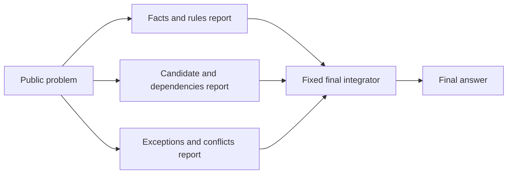
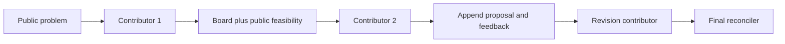
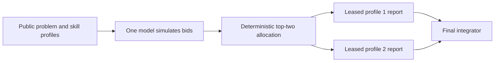
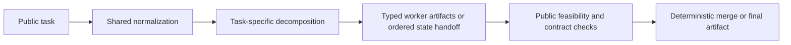

# Preliminary mechanism archive / 前期机制档案

This page preserves mechanism implementations from several preliminary explorations. Their tasks, protocols, controls and experimental conditions differ. They are **not one simultaneous comparison, not the main research results, and not a leaderboard**. A named implementation is not evidence that it improved performance.

本页收录多个前期探索中的机制清单。它们不属于同一组比较，也不是当前主研究的结果；不能将条目数量或旧探索成绩当作统一排名。当前九种策略的构建与证据请看[主架构目录](../../docs/architecture_catalog.md)。

## Archived named configurations

[architectures.py](../../orgbench/architectures.py) and [artifact_org.py](../../orgbench/artifact_org.py) contain the following 12 named configurations. Their older tasks included evidence resolution, planning and sequential-state problems; they are not the current three code-repair families. Some earlier studies had floor effects, redundant review controls or invalid infrastructure. A history entry means the implementation exists and was explored under its own version, **not that it has a valid confirmation score in the main study**.

The nine current configurations plus these 12 historical names give **21 named configurations across studies**. Several share a mechanism; this is neither 21 independent organizational theories nor a unified 21-way ranking.

| Historical name | Information flow | Purpose / important control | Validation status in this release |
|---|---|---|---|
| `single` | Public problem → one answer | Original one-solver baseline; see the current [one-shot card](../../docs/architecture_catalog.md#plain-single) for the analogous shape, not identical task/protocol | Older benchmark only; no main-study score |
| `single_refine` | Same problem/previous answer/public feasibility → repeated revision | Original refinement baseline; differs from current [self-review](../../docs/architecture_catalog.md#single-self-review) and pass-then-stop policies | Historical baseline; do not reuse its result as the current strong control |
| `hierarchy` | Router → two exclusive briefs/reports → manager | Original role delegation; current [hierarchy card](../../docs/architecture_catalog.md#hierarchy-tool) uses code/public-execution rules | Older task/protocol, no main-study score |
| `fixed_dag` | Three fixed isolated perspectives → final integrator | Predeclared graph without adaptive member selection | Historical mechanism; not formally compared on current code tasks |
| `blackboard` | Sequential proposals append to shared board, with public feasibility annotations → revision → reconciler | Shared artifacts and feedback, rather than isolated branches | Historical mechanism; no current-cohort confirmation |
| `bazaar` | Three isolated complete answers → public feasibility filter → model adjudicator | Candidate diversity with a model selector; differs from current deterministic-public-selector variants | Historical mechanism; no current-cohort confirmation |
| `market` | One bid simulator → deterministic allocation to two prompt-based skill profiles → reports → integrator | Test allocation overhead using uncalibrated self-reported bids | Mechanism prototype; no current-cohort confirmation or calibrated-market claim |
| `adaptive` | Explicit public task family chooses self-refinement, fixed DAG or blackboard | Predeclared family routing; not a learned per-instance policy | Historical route, distinct from `adaptive_tools`; no main-study score |
| `blackboard_no_validation` | Same shared-board flow, without intermediate feasibility annotations | Ablate the feedback gate while retaining the old blackboard workflow | Historical ablation only, not a current formal feedback-effect estimate |
| `artifact_contracts` | Shared normalization → task-specific typed work units → feasibility checks/state handoff → deterministic merge | Make artifact boundaries and task-specific contracts executable | Historical specialized prototype; not a generic autonomous organization |
| `artifact_single` | Same normalization/decomposition hints/objective tools → one logical solver | Control for benefits introduced by deterministic preprocessing/tools | Historical matched-tool control; not the main-study tool-single score |
| `contract_adaptive` | Evidence tasks → artifact contracts; planning/sequential tasks → artifact single | Development-fixed route that preserves single-agent state where specified | Historical routing prototype; no current-cohort confirmation |

Four distinct historical shapes are illustrated below. Calls remain subject to their own archived protocol; these diagrams are not new performance results.

### Historical fixed DAG

The three reports are isolated until integration. The graph and briefs are fixed, rather than optimized for a task or learned from confirmation outcomes.

### Historical shared blackboard

Later contributors can see earlier board entries. A previous claim is not automatically verified; the ablation omits the intermediate public-feasibility annotations. This is not a full ant-colony system and not evidence of complete decentralization.

### Historical uncalibrated market

The bids come from a solicitation simulator, not separately measured worker capabilities. The two profiles use the same underlying model, and their scores are not calibrated success probabilities. This is not a reproduction of a calibrated auction protocol or Agora.

### Historical typed-artifact contracts

Evidence work can be sharded, planning branches produce submitted feasible candidates, and sequential work preserves ordered state handoff. Public feasibility and an objective rank of submitted candidates do not prove exhaustive search or optimality. `artifact_single` receives the same deterministic tools so that preprocessing is not attributed to the organization alone.

The market prototype does not calibrate bids using held-out capability evidence. The blackboard is not an implementation of ant-colony optimization. Neither is a faithful reproduction of a similarly named paper or framework.

No official DSH deployment or persistent-ticket workload was executed. The local hierarchy therefore does not establish that this project outperforms DSH's runtime, attention-management or multi-task behavior.
