# Architecture and strategy catalog

An organization is defined here by executable scheduling, information access, artifact selection and stopping rules. A role name alone is not an organization. The controlled tool study compares the nine local implementations documented below.

## Shared construction

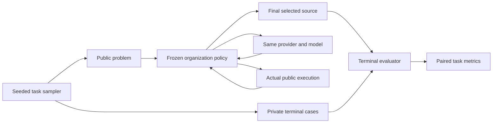

Private cases and terminal scores have no return path to the organization. Only development outcomes enter candidate selection. Confirmation scores never change the frozen policy.

## Current nine mechanisms

| Name | Model stages and information flow | Selection and stop | Role in the study |
|---|---|---|---|
| `plain_single` | One complete program from the public problem | Check public examples once; stop even on failure | Development-only low-overhead control |
| `single_tool` | Complete program; later calls see its source and actual public failure | Stop immediately on public pass; otherwise bounded repair | Strong single-agent control |
| `single_self_review` | Same solver: draft → self-review → revision; complete conversation is preserved once | Three mandatory calls; public nonregression selection; up to two failure repairs | Primary control |
| `hierarchy_tool` | Router → two isolated analytical reports → complete-program integrator | Public check, then at most one failure repair | Hierarchical control |
| `best_of_three` | Three isolated complete programs with fixed diverse instructions | Rank by actual public checks; fixed ascending branch ID breaks ties; bounded repair | Independent-search control |
| `bazaar_tool` | Two isolated complete programs | Same public evidence selects a branch; bounded failure repair | Candidate |
| `contract_team` | Draft → independent auditor → complete-program revision | Public nonregression selection; bounded failure repair | Candidate |
| `adaptive_tools` | Frozen public specification/rule score ≥25 chooses `contract_team`, otherwise `single_tool` | Inherits the selected policy | Candidate; effectively template routing here |
| `evidence_gated` | Draft → actual public check; one bounded repair on failure, or fixed source/spec risk triggers independent audit and revision | Successful first repair stops; otherwise fixed gate and public nonregression selection | Candidate; unconfirmed until fresh evaluation |

Source: [tool_organizations.py](../orgbench/tool_organizations.py), [advanced_organizations.py](../orgbench/advanced_organizations.py). Construction and per-stage allowances are frozen with the study source hash.

The self-review and audit team match mandatory call count and 60%/10%/remaining output allowances. Actual token consumption can differ. Complete history is represented as original messages plus short followups; transport prompts are not recursively stored as messages.

Best-of-three is public-test selection, not majority voting. An auditor's counterexample or expected value is an unverified hypothesis. This implementation does not execute invented counterexamples using a hidden oracle.

## Reading the diagrams / 如何读下面的图

Every model role receives the same applicable public task specification and uses the same model/provider. Arrows show information access and stage order. Forked branches are information-isolated; **their calls are serial within a cell in this implementation**, not a claim of parallel speedup. Four different study cells can run concurrently. The final terminal evaluator is outside every diagram and never sends hidden results back.

The shared per-cell ceilings are five logical model calls, 12,000 output tokens and a 32,000-input-token conservative preflight/observed-usage guard. Percentage allocations below are stage ceilings; unused allowance is released. They do not guarantee equal actual cost. A run that cannot complete its declared policy is recorded as failed, with best-effort incumbents retained separately.

Evidence labels below distinguish **development only** (nine tasks; exploratory) from **independent confirmation cohort** (60 fresh tasks, same tasks across five arms). A completed confirmation cohort is not itself a positive superiority result. None of the new router's four preregistered superiority comparisons passed. See [results and statistical bounds](results.md) and [conclusions](conclusions.md).

### 1. `plain_single` — one-shot / 单次求解

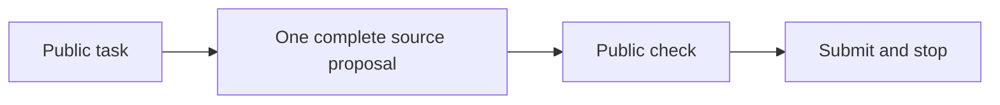

- **Roles/context:** one solver sees the full public specification, wrong starter, examples and supported-language contract. No later solver or reviewer is called.
- **Stop/acceptance:** always stop after the first proposal and public check, including a failing check. No repair or branch selection occurs.
- **Overhead:** exactly one model call, with access to the remaining output allowance. The check is external execution, not another model vote.
- **Evidence:** development **5/9**; **development only**, not one of the five confirmation arms. It measures low-overhead generation, not an equal-compute test of collaboration.

### 2. `single_tool` — grounded repair / 工具单体

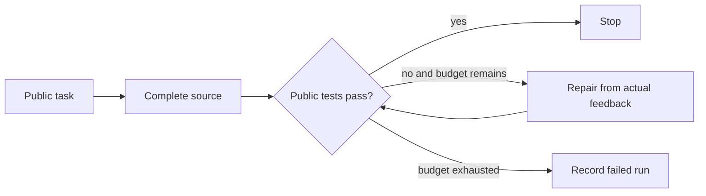

- **Roles/context:** each solver turn receives the public task, selected previous source and actual public-example/syntax feedback. It does not receive hidden cases or another worker's hypotheses.
- **Stop/acceptance:** passing public tests stops the loop immediately. Only real public failure triggers repair; the fixed public ranking retains the best incumbent.
- **Overhead:** one to five calls; no forced review after a public pass. The first call may use the entire remaining output allowance.
- **Evidence:** development **7/9**; confirmation **34/60 (56.7%)**, mean **10,514 input+output tokens/task**. This is the low-overhead strong single-agent control, rather than the weaker one-shot control.

### 3. `single_self_review` — retained-history review / 单体自检

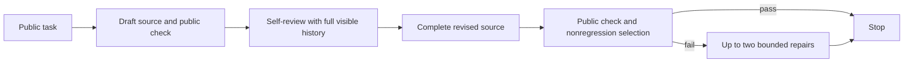

- **Roles/context:** one logical solver continues with its earlier task, draft, actual public feedback and self-review. History is serialized once as original messages and short followups, without recursively copying transport prompts.
- **Stop/acceptance:** draft, review and revision are mandatory even if the initial public tests pass. Public-quality nonregression selection prefers the revision on a tie; only a failing incumbent is repaired further.
- **Overhead:** three to five calls; mandatory stage ceilings are 60% draft, 10% review, then available remainder for revision. Full history can consume more input than a restricted audit context.
- **Evidence:** development **9/9**; confirmation **47/60 (78.3%)**, mean **16,896 tokens/task**. This was the **predeclared primary control** and had the highest confirmation point estimate; that is not a proof of universal or pairwise significant superiority.

### 4. `hierarchy_tool` — router, reports, integrator / 层级协作

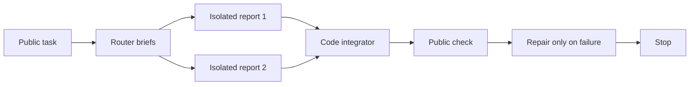

- **Roles/context:** the router receives the public problem and issues briefs. Each worker sees that problem and its own brief, not the other report. The integrator sees the public task and both reports. Worker reports may contain proposals, but are not independently verified solutions.
- **Stop/acceptance:** externally check the integrated code; permit at most one public-failure repair. The reports' claimed expected outputs are hypotheses.
- **Overhead:** four mandatory calls, up to five total. Nominal ceilings: router 10%, each report 15%, integrator 50%, then actual remaining allowance for repair.
- **Evidence:** development **4/9**; confirmation **32/60 (53.3%)**, mean **17,205 tokens/task**. This is a simplified hierarchy mechanism, not a run of the official DSH prototype.

### 5. `best_of_three` — independent complete candidates / 三候选择优

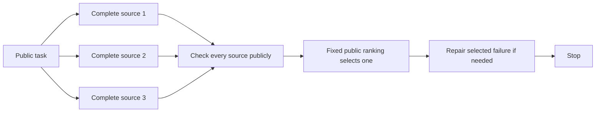

- **Roles/context:** three source generators receive the same task with fixed different instructions. They cannot see other sources or other branches' feedback. The selector sees actual public rankings only.
- **Stop/acceptance:** rank by public success, passed-example count and syntax; use ascending branch ID for ties. Never select using hidden scores. A selected public failure may receive up to two repairs.
- **Overhead:** three to five calls; each initial branch has a 25% output ceiling, with actual unused/remainder allowance available afterward.
- **Evidence:** development **5/9**; confirmation **38/60 (63.3%)**, mean **13,047 tokens/task**. This controls for more independent attempts. It is **best-of-N selection, not majority voting**.

### 6. `bazaar_tool` — two competing branches / 集市式

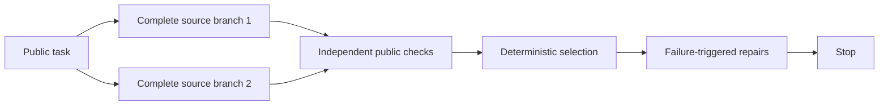

- **Roles/context:** both branches solve the complete task. Neither sees the other candidate or its feedback. There is no open membership, persistent community or reputation market in this prototype.
- **Stop/acceptance:** the same public ranking and fixed low-branch-ID tie break select the incumbent. Repair only after real public failure and stop upon public pass or resource exhaustion.
- **Overhead:** two to five calls. Each initial branch has a 40% output ceiling; repairs use actual remaining allowance.
- **Evidence:** development **7/9**; **development only** in this study. It was not selected for a standalone 60-task confirmation, so no confirmed superiority/inferiority conclusion is available.

### 7. `contract_team` — independent audit / 契约审计团队

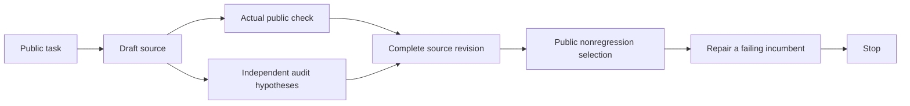

- **Roles/context:** the initial solver sees the public task. The auditor receives that task and candidate source, without the solver's conversation history; the auditor's prompt does not receive the execution feedback as an extra observation. The reviser receives source, actual public feedback and audit hypotheses.
- **Stop/acceptance:** audit and revision are mandatory after the draft, even on initial public pass. Reject public regression; prefer revision on equal public rank. A passing incumbent stops further repair.
- **Overhead:** three to five calls, with 60%/10%/remaining stage ceilings. Audit is counted as a model call; proposed counterexamples are not secretly executed against an oracle.
- **Evidence:** development **7/9**; no standalone all-family 60-task confirmation. It is also the ledger branch of the selected router; that branch's observations are not a general confirmation of this whole policy.

### 8. `adaptive_tools` — fixed public-feature router / 固定特征路由

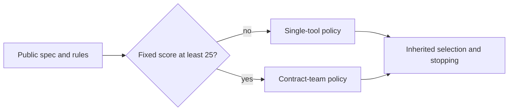

- **Roles/context:** deterministic code reads public specification/rule counts only, then invokes one of the two policies. Routing itself makes no model call and does not read family, candidate output or hidden score.
- **Stop/acceptance:** inherit the selected branch's full behavior. In this generator, scores are constant at versions 21, ledger 31 and configuration 19; routing is therefore effectively by template, not demonstrated sample-level difficulty prediction.
- **Overhead:** one to five calls on the single route, three to five on the audit route. Both use the shared total ceilings; it is not an unbounded ensemble.
- **Evidence:** development **8/9**, selected among four non-control candidates; confirmation **39/60 (65.0%)**, mean **12,323 tokens/task**. **None of its four preregistered superiority comparisons passed.** It was not the overall development winner, since self-review solved 9/9.

### 9. `evidence_gated` — public feedback and static risk / 证据门控

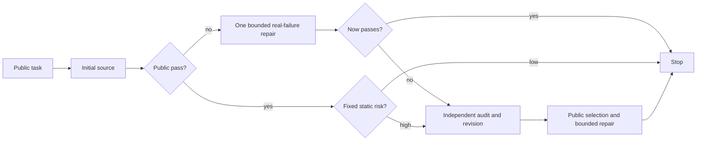

- **Roles/context:** a solver first uses the public task. The gate reads real public feedback and fixed spec/source features. A called auditor sees public task and current source; the reviser also sees actual public feedback and unverified audit hypotheses.
- **Stop/acceptance:** a first repair that passes public tests stops immediately. Otherwise audit on persistent failure, or on initial pass with static risk. Risk is fixed at at least six spec conditional markers and either fewer than three AST branches or fewer than 24 nonblank source lines. It is a heuristic, not a correctness/uncertainty oracle.
- **Overhead:** one to five calls; draft ceiling 60%, first failure repair 20%, audit 10%, revision/remaining repair within the common allowance.
- **Evidence:** development **5/9**; **development only**, no independent confirmation of the gate's benefit. This heuristic does not establish the value of a future conditional-review policy.

## Evidence summary / 证据层级汇总

| Mechanism | Development tasks solved | Independent confirmation tasks solved |
|---|---:|---:|
| plain_single | 5/9 | Not run |
| single_tool | 7/9 | 34/60 |
| single_self_review | 9/9 | 47/60 |
| hierarchy_tool | 4/9 | 32/60 |
| best_of_three | 5/9 | 38/60 |
| bazaar_tool | 7/9 | Not run |
| contract_team | 7/9 | Not run as a standalone all-family arm |
| adaptive_tools | 8/9 | 39/60 |
| evidence_gated | 5/9 | Not run |

Concrete specifications, rules and public input/output examples are in [task examples](task_examples.md). The quality/resource plot is descriptive; the task-family matrix is exploratory, not a new set of confirmed subgroup winners.

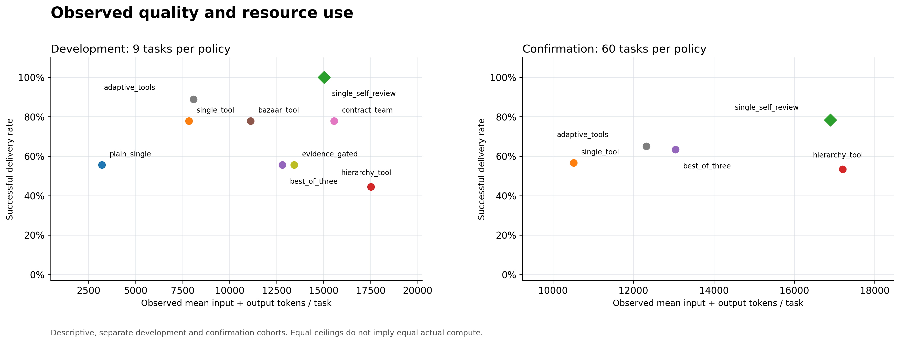

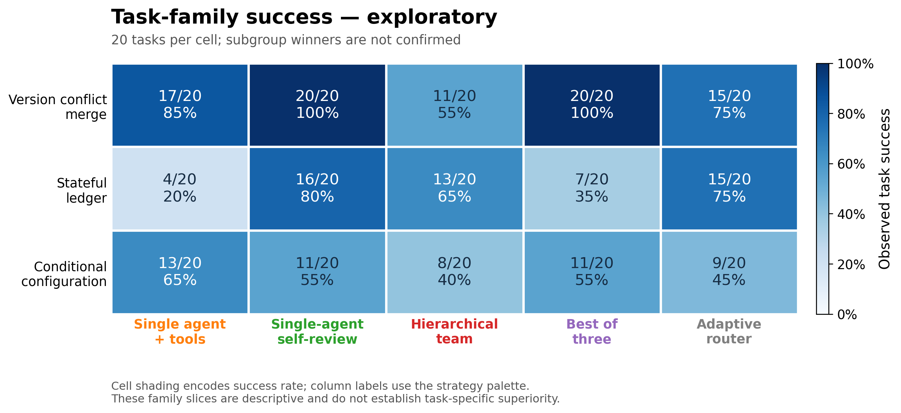

## Extending the comparison

1. Specify who can see which messages, when a node runs, what artifact it produces, how artifacts are accepted and when the run stops.
2. Use the common public-only task projection and real public validator. Record every model, coordination and repair call.
3. Add tests for information boundaries, resource accounting, selection ties, malformed outputs and tool failures.
4. Register the strategy in a **new preregistered study**, with fresh development and confirmation data. Adding source after selection changes its source hash and invalidates continuation of the original study.
5. Report quality, actual consumption and failures against strong single-agent and independent-search controls. Preserve negative and incomplete results.

## Official framework integrations remain future work

An integration should pin the upstream revision, tool adapter, prompts, termination settings and resource accounting, then run the same tasks. A diagram resemblance is insufficient.

For example, AutoGen's documented `SelectorGroupChat` broadcasts messages among participants and selects the next speaker; this is an additional shared-context policy to integrate, not a result already measured here. [Official AutoGen documentation](https://microsoft.github.io/autogen/stable/user-guide/agentchat-user-guide/selector-group-chat.html).

Real-repository evaluation is also separate work. SWE-bench provides real GitHub issue tasks and its Verified subset contains 500 human-filtered instances; adding its harness would test external validity beyond these three synthetic families. No SWE-bench score is reported by this project. [Official benchmark](https://www.swebench.com/).

[Preliminary mechanism archive / 前期机制档案](../archive/preliminary-study/architecture_history.md)
