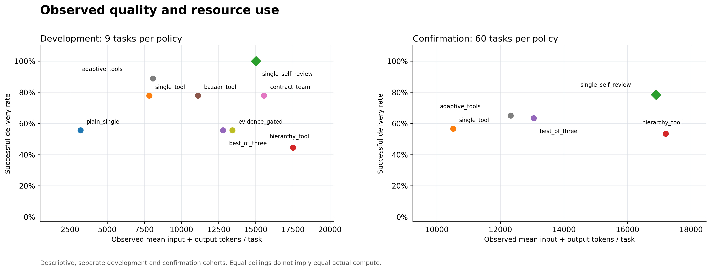
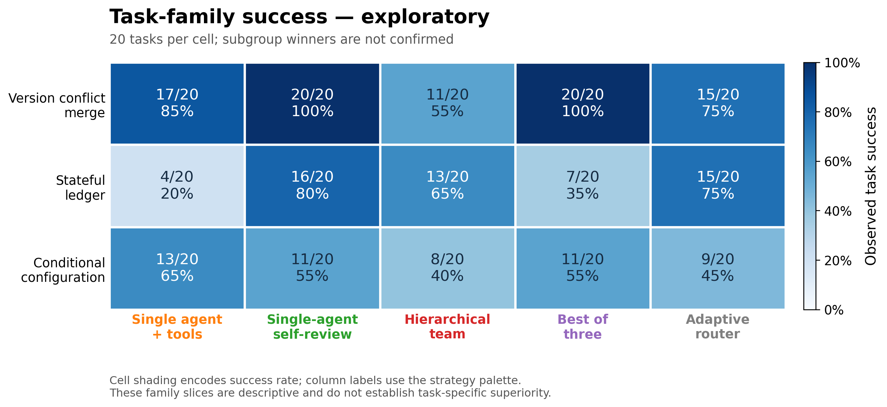

# Conclusions and evidence boundaries / 结论与证据边界

**The current study's candidate did not pass any of its four preregistered superiority comparisons.** The selected router solved 39/60 tasks (65.0%); the predeclared single-agent self-review control solved 47/60 (78.3%). This is a negative result for the candidate's claimed advantage, not proof that all multi-agent systems are ineffective or that self-review is universally optimal.

**当前研究：新路由没有通过任何一项预注册质量优势比较。** 单体自检的观察成功率最高，但不能据此称其在所有任务或所有组织间已经显著最优。

## Main study / 当前完整研究

The study first completed 81 development cells (nine tasks × nine implementations), selected one of four non-control candidates, and then evaluated 60 fresh tasks across five arms, giving 300 confirmation cells. The selected router solved 8/9 development tasks; self-review solved 9/9. Selection among candidates was not an overall development victory.

| Strategy / 策略 | Tasks solved | Success rate | Mean input + output tokens/task |
|---|---:|---:|---:|
| Single-agent self-review / 单体自检 | 47/60 | 78.3% | 16,896 |
| New fixed router / 新固定路由 | 39/60 | 65.0% | 12,323 |
| Best-of-three / 三候选择优 | 38/60 | 63.3% | 13,047 |
| Single + tools / 工具单体 | 34/60 | 56.7% | 10,514 |
| Simplified hierarchy / 简化层级 | 32/60 | 53.3% | 17,205 |

The router minus self-review difference was -13.3 percentage points, with a 95% paired interval of [-28.3, +1.7] points and two-sided p=0.115. Against single+tools, hierarchy and best-of-three, the Holm-adjusted p-values were 0.884, 0.743 and 1.000; none met the preregistered positive-superiority gate. Non-significance is not equivalence or noninferiority.

The router's observed total-token ratio versus self-review was 0.729, approximately 27.1% fewer tokens. Its success-rate point estimate was also lower. The current study defined no efficiency-confirmation gate, so this is not an equal-quality cost-saving result. Tokens measure recorded input/output consumption, not a universal monetary price.

完整统计、配对区间和逐组资源见[双语结果](results.md)；无需API的公开指标复算入口为 `python analysis/analyze_public_results.py`。该入口复算已发布指标的统计，不重新验证原始代码判分。

## Task heterogeneity / 任务差异

| Task family, 20 tasks per arm | Single + tools | Self-review | Hierarchy | Best-of-three | Router |
|---|---:|---:|---:|---:|---:|
| Version conflict resolution / 版本合并 | 17 | 20 | 11 | 20 | 15 |
| Stateful ledger / 状态账本 | 4 | 16 | 13 | 7 | 15 |
| Conditional configuration / 条件配置 | 13 | 11 | 8 | 11 | 9 |

These family observations are exploratory, with only 20 tasks each. They suggest useful questions about ordered state, review and search; they do not establish confirmed family-specific winners. In particular, hierarchy's ledger result was higher than single+tools, even though its overall result was lower. Added coordination cannot be labeled uniformly useful or useless.

The fixed router's ledger branch uses `contract_team`; its version/configuration branches use the same `single_tool` implementation as the control. Its net +5 successes versus the tool single agent decomposes into ledger +11 and the same-algorithm branches -6. This is an observation decomposition containing independent model sampling, not a causal attribution of organizational benefit or harm.

## Interrupted cohort and replacement confirmation / 中断批次与替代确认

The original interrupted cohort stopped at 49/300 because of transport failures and unknown usage. It was invalidated. The replacement confirmation used a new seed with the same candidate, source, model, controls and hypotheses; none of those 49 failed-cohort cells entered the main confirmation. The final 300-cell cohort was complete, with no infrastructure error, unknown usage or actual overrun. Recovery lineage and independent statistical recomputation were checked before release.

原确认批次在49/300处因传输失败与用量未知而中断并失效。替代确认使用全新种子，保持候选、源码、模型、对照和假设不变，旧49次运行未混入当前300次完整确认。发布前已验证恢复继承链及独立统计复算。

## What the experiments do and do not establish / 能说明与不能说明的事

- These are executable **information-flow and resource policies** using one model. They are not official reproductions of DSH, AutoGen or a biological immune system.
- More model calls, role instructions, context retention/isolation and output allocation all change across some policies. Current results do not isolate a pure organization/topology effect.
- Equal per-cell ceilings are not equal actual compute. Audit, integration, repair and failed work count; returning a correct incumbent after an incomplete declared workflow does not replace the primary failed-delivery outcome.
- Public tests are real execution, but passing them does not ensure unseen-case correctness. An auditor's invented counterexample or expected value is unverified, not a new oracle.
- The task population has three finite synthetic families and a restricted AST executor. New seeds do not establish real-repository, long-horizon, multi-task or cross-model generalization.
- Archived preliminary studies and other-backend pilots are separate cohorts. They do not enter the main study's sample, ranking or efficiency comparison.
- Development-only candidates are documented as such. Nine implementations in development and five arms in confirmation do not establish a confirmed nine-way ranking.

## Next direction is not a new result / 后续方向不是新结论

The proposed follow-up asks a narrower question: **when is another review worth its added cost, and when should the workflow stop?** The intended mechanism study uses a shared draft and identical public feedback, then controls what review context is exposed and uses a common revision mechanism. Correction, damage to correct drafts, accepted-output damage and delivery/resource failures must be separated.

That is a research proposal and offline preparation, not a completed follow-up model experiment. No superiority, predictive trigger, immune-style organization or novelty claim for that proposal is established by the current results. Already analyzed tasks cannot become a new policy's blind confirmation.

This repository's completed evidence is best read as a comparative workbench: strong single-agent baselines matter, task conditions matter, and negative results constrain the next experiment. It does not announce a universally optimal agent organization.

Earlier experiments remain available in the [preliminary-study archive](../archive/preliminary-study/README.md). They are preserved for transparency and are not pooled into the main study. / 早期实验保留在[预备研究归档](../archive/preliminary-study/README.md)，供核查历史，不混入当前研究。
