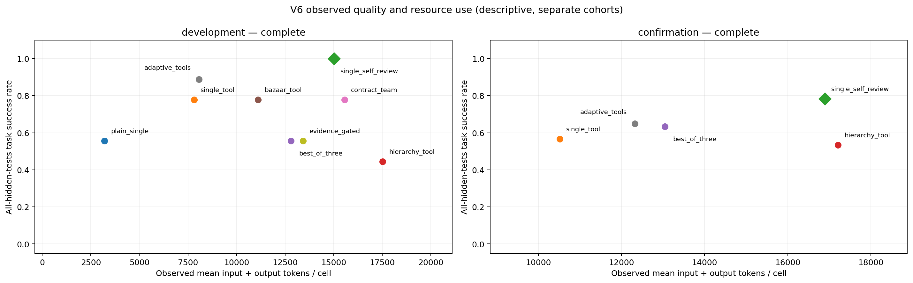

# v6 results / v6结果

最新结论：候选没有通过任何一项预注册质量优势比较。单体自检的成功率点估计最高，不能由此称其普遍最优或已在所有任务上显著优于其他策略。

Research date / 研究日期：2026-11-03 (client context / 客户端上下文).

**State / 状态：completed.**

Frozen candidate / 冻结候选：`adaptive_tools`. Nine development tasks × nine mechanisms, then 60 fresh tasks × five arms. / 先9题×9种机制开发，再60新题×5组确认。

Development `single_self_review` solved 9/9; the selected candidate solved 8/9. Selection was among four non-control candidates, **not first place across all development arms**. / 开发强单体自检9/9、选中候选8/9；候选只在四个非控制组中选，不能称开发总体第一。

## Development (descriptive) / 开发（描述性）

| Strategy / 策略 | Solved / 全对 | Rate / 成功率 | Calls / 调用 | Input tokens | Output tokens | Total tokens | Mean / P95 seconds |
|---|---:|---:|---:|---:|---:|---:|---:|
| `plain_single` | 5/9 | 55.6% | 9 | 22,200 | 6,619 | 28,819 | 6.82881 / 9.91847 |
| `single_tool` | 7/9 | 77.8% | 19 | 56,911 | 13,527 | 70,438 | 13.85 / 29.0384 |
| `single_self_review` | 9/9 | 100.0% | 28 | 112,012 | 23,215 | 135,227 | 28.4654 / 35.3594 |
| `hierarchy_tool` | 4/9 | 44.4% | 42 | 128,935 | 28,755 | 157,690 | 32.7503 / 45.8051 |
| `best_of_three` | 5/9 | 55.6% | 33 | 88,629 | 26,551 | 115,180 | 26.3925 / 41.4069 |
| `bazaar_tool` | 7/9 | 77.8% | 27 | 77,819 | 22,192 | 100,011 | 22.2311 / 50.4062 |
| `contract_team` | 7/9 | 77.8% | 31 | 112,050 | 27,961 | 140,011 | 30.3261 / 40.1774 |
| `adaptive_tools` | 8/9 | 88.9% | 19 | 59,076 | 13,569 | 72,645 | 14.5567 / 25.4227 |
| `evidence_gated` | 5/9 | 55.6% | 29 | 98,336 | 22,557 | 120,893 | 23.321 / 50.5314 |

## Confirmation / 确认

| Strategy / 策略 | Solved / 全对 | Rate / 成功率 | Calls / 调用 | Input tokens | Output tokens | Total tokens | Mean / P95 seconds |
|---|---:|---:|---:|---:|---:|---:|---:|
| `single_tool` | 34/60 | 56.7% | 161 | 511,313 | 119,526 | 630,839 | 16.7514 / 35.1076 |
| `single_self_review` | 47/60 | 78.3% | 201 | 858,464 | 155,309 | 1,013,773 | 25.9902 / 40.3688 |
| `hierarchy_tool` | 32/60 | 53.3% | 270 | 836,756 | 195,550 | 1,032,306 | 30.9188 / 40.2284 |
| `best_of_three` | 38/60 | 63.3% | 223 | 604,175 | 178,643 | 782,818 | 25.8779 / 33.4545 |
| `adaptive_tools` | 39/60 | 65.0% | 176 | 592,714 | 146,636 | 739,350 | 20.9036 / 42.7307 |

## Predeclared quality comparisons / 预注册质量比较

Primary and secondary declarations are separate. Not confirming superiority is not evidence of equivalence. / 主、次声明分别判断；没有确认优势不等于证明等效。

| Family / 层级 | Control / 对照 | Tasks | Delta | 95% CI | Raw p | Holm p | Declaration / 声明 |
|---|---|---:|---:|---|---:|---:|---|
| primary | `single_self_review` | 60 | -13.3% | [-28.3%, 1.7%] | 0.115318 | — | not confirmed / 未确认 |
| secondary | `single_tool` | 60 | 8.3% | [-8.3%, 25.0%] | 0.442068 | 0.884137 | not confirmed / 未确认 |
| secondary | `hierarchy_tool` | 60 | 11.7% | [-5.0%, 28.3%] | 0.247789 | 0.743366 | not confirmed / 未确认 |
| secondary | `best_of_three` | 60 | 1.7% | [-13.3%, 16.7%] | 1 | 1 | not confirmed / 未确认 |

Token ratios and intervals are descriptive; v6 has no efficiency-confirmation gate. / Token比和区间只描述，本轮没有效率确认门。

| Control | Candidate/control total-token ratio | 95% paired interval |
|---|---:|---|
| `single_self_review` | 0.729305 | [0.611216, 0.852068] |
| `single_tool` | 1.17201 | [0.933807, 1.49623] |
| `hierarchy_tool` | 0.716212 | [0.606321, 0.831136] |
| `best_of_three` | 0.944472 | [0.798182, 1.10003] |

## Task families and failures (exploratory) / 分族与失败（探索性）

| Family / 任务族 | Arm / 策略 | n | Solved | Calls | Total tokens | Public-pass hidden-fail | Budget stops |
|---|---|---:|---:|---:|---:|---:|---:|
| `code_config` | `single_tool` | 20 | 13/20 | 47 | 165,991 | 2 | 0 |
| `code_config` | `single_self_review` | 20 | 11/20 | 70 | 351,373 | 2 | 4 |
| `code_config` | `hierarchy_tool` | 20 | 8/20 | 90 | 332,016 | 2 | 0 |
| `code_config` | `best_of_three` | 20 | 11/20 | 76 | 243,830 | 3 | 0 |
| `code_config` | `adaptive_tools` | 20 | 9/20 | 62 | 234,410 | 3 | 0 |
| `code_ledger` | `single_tool` | 20 | 4/20 | 81 | 328,057 | 1 | 0 |
| `code_ledger` | `single_self_review` | 20 | 16/20 | 69 | 347,399 | 0 | 2 |
| `code_ledger` | `hierarchy_tool` | 20 | 13/20 | 88 | 329,133 | 1 | 0 |
| `code_ledger` | `best_of_three` | 20 | 7/20 | 85 | 303,723 | 2 | 0 |
| `code_ledger` | `adaptive_tools` | 20 | 15/20 | 69 | 308,667 | 2 | 0 |
| `code_versions` | `single_tool` | 20 | 17/20 | 33 | 136,791 | 0 | 0 |
| `code_versions` | `single_self_review` | 20 | 20/20 | 62 | 315,001 | 0 | 0 |
| `code_versions` | `hierarchy_tool` | 20 | 11/20 | 92 | 371,157 | 0 | 0 |
| `code_versions` | `best_of_three` | 20 | 20/20 | 62 | 235,265 | 0 | 0 |
| `code_versions` | `adaptive_tools` | 20 | 15/20 | 45 | 196,273 | 0 | 0 |

`input_budget_exhausted` inside declared caps is a legitimate failed task, not automatically an infrastructure error or whole-study invalidation. Actual overruns are separately guarded. All failed/null results remain visible. / 声明上限内的input_budget_exhausted是合法性能失败，不自动当基础设施错误或令整轮无效；真实超限另有守卫，失败及负结果全部保留。

The model, finite generated task population, restricted AST, prompts and stage allocations limit generalization. Family analyses are exploratory. v5 and the native pilot are separate cohorts; no pooling or cross-backend efficiency comparison is made. / 结论限于该模型、有限生成题、受限AST及提示/额度；分族只探索，v5和原生pilot分开，不拼样本或同比效率。

Machine-readable sanitized results: [v6 state](../results/v6/state.json), [decision](../results/v6/decision.json), [development cells](../results/v6/dev_cells.jsonl), [confirmation cells](../results/v6/holdout_cells.jsonl). Original registered materials: [protocol](protocol_v6_original.md), [plan](study_v6_plan_original.json).

This is the v6r1 infrastructure recovery: the original 49-cell confirmation was invalidated for unknown transport usage and is excluded. Development data, candidate, code, model, controls and hypotheses were unchanged. 本页为v6r1独立确认；原49次失效记录未混入，开发、候选、代码、模型、对照和假设均保持不变。

## Interpretation and next experiments / 解读与下一阶段

The router's quality difference versus self-review was -13.3 percentage points, 95% paired interval [-28.3, +1.7], p=0.115. Its observed token ratio was 0.729, but lower observed quality prevents an equal-quality efficiency claim. No equivalence claim follows from non-significance.

候选相对自检的成功率差为-13.3个百分点，95%配对区间[-28.3,+1.7]，p=0.115。观察Token少约27.1%，同时成功率点估计较低，不能称同质量省成本；不显著也不表示等效。

| Task family / 任务族 | Single + tools | Self-review | Hierarchy | Best-of-three | New router |
|---|---:|---:|---:|---:|---:|
| Version conflict merge / 版本合并 | 17/20 | 20/20 | 11/20 | 20/20 | 15/20 |
| Stateful ledger / 状态账本 | 4/20 | 16/20 | 13/20 | 7/20 | 15/20 |
| Conditional configuration / 条件配置 | 13/20 | 11/20 | 8/20 | 11/20 | 9/20 |

These are exploratory family observations, not confirmed task-specific winners. On ledger tasks the router uses an audit team; on versions/configuration it runs the same single-tool code as the single control. The net +5 router successes versus that control decomposes into ledger +11 and same-algorithm branches -6. That is an observation decomposition, not a causal contribution estimate.

分族只有20题，以上只是探索性观察。账本分支采用审计团队；版本/配置分支仍是同一单体算法。候选对工具单体总体净多5次，来自账本+11、同算法分支-6，不能把后者的采样差归为组织效果，也不能把该加法称因果贡献。

Next, prioritize fresh real-repository/tool tasks, context-memory ablations and workloads with resource contention or failures. Additional social/organizational mechanisms should be tested where their scheduling and governance rules actually matter. Freeze a new protocol before new model calls; do not enlarge this retired confirmation until a desired result appears.

下一阶段优先增加真实工具任务、上下文保留/裁剪消融，以及资源争用、故障恢复与持续多任务场景，再检验新的组织机制。新增实验应先冻结新协议；不能反复追加这批确认题直到出现胜出。

Offline metric replay / 不调用API复算指标：`python analysis/analyze_public_results.py`。它复算公开指标的统计，不声称重新验证原始程序判分。

